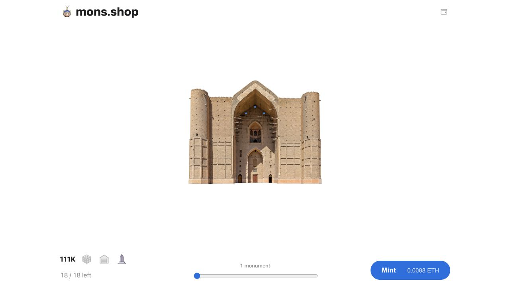

# 111K Sepolia v10 — registered delivery configurations

**Live and open.** V10 replaces V9 with one constructor-initialized redemption configuration. The API, storefront, commerce controls and reveal deployment are active on the new collection.

| Item | Value |
| --- | --- |
| Contract | [`0xc495131aab4eddb3c9a90a761bd0ab1550ce35a5`](https://sepolia.etherscan.io/address/0xc495131aab4eddb3c9a90a761bd0ab1550ce35a5) |
| Deployment block | 12041084 |
| Deployment | [Transaction](https://sepolia.etherscan.io/tx/0x32cbca1ef5d48cfc0743f6ba15819dba82ab8490437e432d624eda6ed972e9f1) |
| Sale opening | [Transaction](https://sepolia.etherscan.io/tx/0xf6bc5b3e8824c59612c9b02bf5cf8474b2ca38fc290a0e41d94c8ed7706a81fb) |
| Source | [Verified on Sourcify](https://repo.sourcify.dev/11155111/0xc495131aab4eddb3c9a90a761bd0ab1550ce35a5) |
| Storefront | [111K testnet](https://mons.shop/111k_devnet) |
| Initial configuration | ID 1, 100% to `0x5555555555555555555555555555555555555555` |
| Additional configuration capacity | 31, registered by the owner when needed |
| Withdrawal | Public `releaseDelivery()` with no arguments |
| Metadata | `https://cdn.mons.shop/111k-sepolia/v10/` |

The constructor created exactly one configuration with no secondary receiver and no secondary share. Backend quotes sign and persist configuration IDs. Registry entries and earned allocations are immutable; cumulative accounting moves split calculations to withdrawal. The normal no-argument call attempts every registered configuration, retaining failed payouts; the individual fallback supports receivers requiring more callback gas. Mint proceeds remain separate.

All 344984 metadata objects were [published](metadata-publication.json) and [verified](metadata-verification.json) before deployment. [Closed-sale verification](deployment-closed.json) established zero issuance and zero proceeds, and the [delivery configuration check](delivery-config-verification.json) verified config 1 and simulated the public withdrawal without committing state. No QA tokens were minted on the live collection.

V9 `0x4d127fceeaa8b652744c4cb1f62f1101290180a8` remains paused for sales, redemptions and new reveal admission. Its confirmed test order, quote, checkout/attempt, claimed claim, cursor and recovery projection were [privately backed up](reset-backup-verification.json) and [reset](reset-verification.json) while its old API scope remained paused. Migration 0047 was applied afterward, with no historical configuration-ID backfill. Shared accounts, addresses, authentication, unrelated drops, old NFTs, metadata prefixes and permanent reveal records were preserved. The [mainnet comparison](mainnet-approved-diff.json) found no metadata or registry changes.

[Validation](validation.json) records 225 passing Solidity tests, 157 gas benchmarks, 39 tooling tests, 2891 API tests, 50 native runtime tests, and the extended invariant campaign of 65536 calls with zero reverts. The full frontend run passed 4771 cases; its unchanged large metadata-restoration case exceeded its 90-second deadline under load and passed on isolated retry in 76.6 seconds without changing code or the timeout. All frontend assertions, the production build, bundle checks, and [local lifecycle](local-lifecycle.json) passed. Three optional public-fork tests were skipped.

The production build uses Solidity 0.8.30 and 200 optimizer runs, with a 24048-byte runtime and 528 bytes of EIP-170 headroom. [Source manifest](source-manifest.json), [source verification](NFT111K.sourcify-verification.json), [application versions](application-release.json), [deployed API bindings](api-bindings-verification.json), [database checks](database-preflight.json), [HTTP acceptance](http-preopening.json), [browser acceptance](browser-acceptance.json), and [release summary](release.json) preserve the evidence. The browser confirmed closed minting before the opening transaction and an enabled mint button afterward, with 18/18 monuments available and no console warnings or errors.

