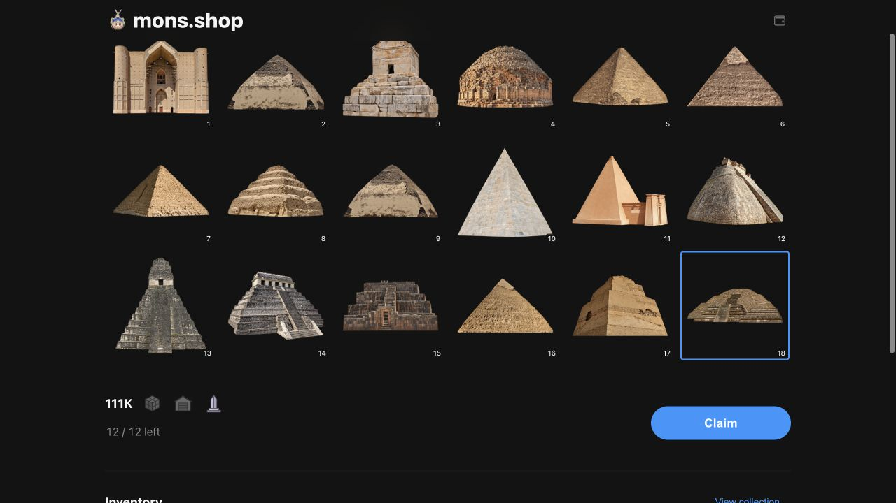

# 111K Sepolia v11 — selected relic claims

**Live and open.** The [111K testnet page](https://mons.shop/111k_devnet) now offers individual relic selection and claims. All eighteen IDs stay visible; claimed IDs are dimmed and unavailable. The grid replaces the mint preview without increasing the panel height. There is no relic quantity slider, price, or owner caption.

| Item | Value |
| --- | --- |
| Contract | [`0xef5ffe06eb0d94a575656eb6ffcd97b8e2121b1c`](https://sepolia.etherscan.io/address/0xef5ffe06eb0d94a575656eb6ffcd97b8e2121b1c) |
| Deployment block | 12042214 |
| Deployment | [Transaction](https://sepolia.etherscan.io/tx/0x303bab0b8efa555aa12c1134e6f0304e0c76b4cfb7d9cf69940fafe7f08ab68b) |
| Reservation | [12 relics and 0.012 test ETH](https://sepolia.etherscan.io/tx/0xfe8e6a183fb0bf5a73a6becb89ac4d831ba9b0a3513e1d78bab947f1ca122109) |
| Sale opening | [Transaction](https://sepolia.etherscan.io/tx/0xdc4992765d511a91d42abe8c10af93c0d0c06f3728a78813165af236c6dca0e3) |
| Direct claims | [Etherscan Write Contract](https://sepolia.etherscan.io/address/0xef5ffe06eb0d94a575656eb6ffcd97b8e2121b1c#writeContract) → `claimRelic(id)` |
| Source | [Etherscan exact match](https://sepolia.etherscan.io/address/0xef5ffe06eb0d94a575656eb6ffcd97b8e2121b1c#code), [Sourcify](https://repo.sourcify.dev/11155111/0xef5ffe06eb0d94a575656eb6ffcd97b8e2121b1c) |
| Metadata | `https://cdn.mons.shop/111k-sepolia/v11/` |

The owner reserved twelve relics before opening, consuming 1,332 crate allocations and leaving 4,223 for public sales. The 0.012 ETH deposit is recorded as mint proceeds and remains undistributed. Each of the four addresses in the [explicit Sepolia profile](../../onchain/ethereum/config/free-mints.sepolia.json) has three unused relic claims and no free crate or warehouse allowance. [Final acceptance](http-open.json) simulated claiming ID 18 from each wallet without sending transactions. No QA NFTs were minted and all twelve claim slots remain available at acceptance.

Availability uses one bounded contract bitmap view, batched with supply and allowance reads at a canonical latest block. The visible panel refreshes every four seconds, refuses stale/error state, and rechecks before submitting. The bitmap remains set after transfer, unboxing, or delivery. Direct claims from Etherscan appear through the same read path. Relic claims have independent pending/recovery handling and require no physical-receipt authentication.

The generic allowance configuration remains empty, and ordinary deployment never reserves supply or opens sales. The test preset rejects any chain other than Sepolia. Mainnet requires its own future preorder addresses, payment, explicit reservation, and explicit opening.

All 344,984 objects were [published](metadata-publication.json) and [fully verified](metadata-verification.json) at the fresh v11 prefix before deployment. V10 sales, redemptions and new reveal admission are paused. Its single reconciliation cursor was privately backed up and [reset](reset-result.json) after the maintenance drain; no orders, quotes, checkouts or claims existed in that scope. Shared accounts, other drops, old NFTs, historical metadata and reveal records were preserved. The [mainnet comparison](mainnet-approved-diff.json) confirms no mainnet metadata or registry changes.

[Validation](validation.json) covers contract/invariant tests, 160 gas benchmarks, 139 compiler write comparisons, API/frontend/runtime suites, build checks, and [local lifecycle/reorg tests](local-lifecycle.json). The runtime is 23,922 bytes, with 654 bytes of EIP-170 headroom. [Browser acceptance](browser-acceptance.json) confirms all 18 images load, desktop/mobile panel heights stay unchanged, and the opened Claim control enables after selection. [Application versions](application-release.json) and the [frozen source manifest](source-manifest.json) identify the exact deployed working-tree inputs; the base commit is recorded separately from those hashes.

