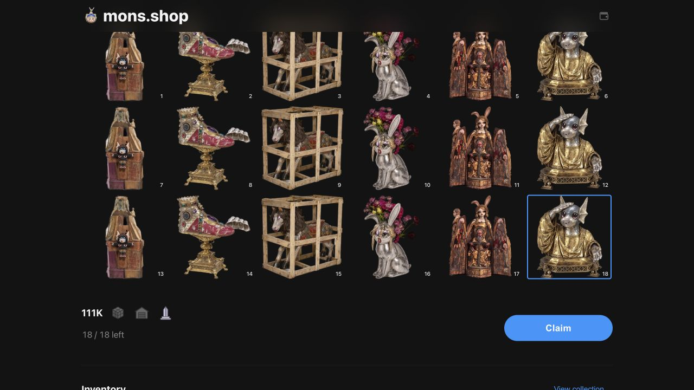

# 111K Sepolia v12 — final build and 18 relic claims

**Live and open.** The [111K testnet page](https://mons.shop/111k_devnet) uses the final contract, with eighteen reserved relic claims across seven wallets and the new `/111k/relics/` image paths.

| Item | Value |
| --- | --- |
| Contract | [`0x320cf00a3606350821ed90ea435e93955b180874`](https://sepolia.etherscan.io/address/0x320cf00a3606350821ed90ea435e93955b180874) |
| Deployment block | 12043279 |
| Deployment | [Transaction](https://sepolia.etherscan.io/tx/0xbc62c8a2acb8b8a5efce5012d40ade26c1cc466ff968facc24faa45623003d19) |
| Reservation | [18 relics and 0.018 Sepolia ETH](https://sepolia.etherscan.io/tx/0xf560f6feca9cd6bdb091626ec4585e5ff26e950a77bd9d544ec9a45a934322aa) |
| Sale opening | [Transaction](https://sepolia.etherscan.io/tx/0x35082a5342ec3cb5a8b5324c3ed84c000d5a580dd9c8ac6b21656ccdd01f969c) |
| Direct claims | [Etherscan Write Contract](https://sepolia.etherscan.io/address/0x320cf00a3606350821ed90ea435e93955b180874#writeContract) → `claimRelic(id)` |
| Source | [Etherscan exact match](https://sepolia.etherscan.io/address/0x320cf00a3606350821ed90ea435e93955b180874#code), [Sourcify](https://repo.sourcify.dev/11155111/0x320cf00a3606350821ed90ea435e93955b180874) |
| Metadata | `https://cdn.mons.shop/111k-sepolia/v12/` |

The [confirmed reservation](deployment-reserved.json) allocates 1,998 crates to eighteen relics, leaving 3,557 for public sales. At [final acceptance](http-open.json), the 0.018 ETH deposit remained undistributed, no NFTs had been minted, and all eighteen claim slots were unused. Claiming ID 18 was simulated successfully for each of the seven wallets without sending claim transactions.

The [Sepolia allowance profile](../../onchain/ethereum/config/free-mints.sepolia.json) preserves three relic claims for each of the four original wallets and adds two each for three new wallets: eighteen claims across seven addresses. There are no free crate or warehouse allowances. The generic configuration remains empty, and the test preset rejects other chains. Mainnet requires its own future preorder configuration and explicit reservation.

The final implementation from `5d5c2386` uses Solidity 0.8.38, 500 optimizer runs, the legacy pipeline, and Prague. Its refactors skip zero-value mint revenue writes, move the physical claim's receipt offset outside the loop, and cache payout accounting for restoration after a failed receiver call. The ABI, storage layout, authorization formats, and callback ordering are preserved. Runtime bytecode is 24,401 bytes, with 175 bytes of EIP-170 headroom. The [frozen source manifest](source-manifest.json), [Etherscan verification](etherscan-verification.json), and [Sourcify verification](NFT111K.sourcify-verification.json) bind the deployed code and constructor inputs.

All 344,984 metadata objects were [published](metadata-publication.json) at the fresh v12 prefix. The [amendment diff](metadata-amendment-diff.json) confirms that only the eighteen relic JSONs changed, using `https://wip.lil.org/111k/relics/1.webp` through `18.webp`, with no objects added or removed. The [amended full collection](metadata-amendment-verification.json) is verified; v11 and mainnet metadata remain unchanged. The [amendment record](metadata-amendment.json) preserves the parent freeze and signed transaction history. Future generated relic metadata uses the same new image paths.

V11 sales, redemptions, and new reveal admission are paused. Its single reconciliation cursor was privately backed up and [reset](reset-result.json) within the old collection scope; no orders, quotes, checkouts, or claims existed there. Old NFTs, metadata, reveal ledgers, shared accounts, and other drops remain preserved. [Cutover acceptance](cutover-acceptance.json) and [application versions](application-release.json) record the matching v12 storefront, API, commerce, and reveal configuration.

[Validation](validation.json) records the focused allowance/deployment checks, retained final-implementation contract tests, 160 gas benchmarks, 139 compiler write comparisons, both extended invariant campaigns, lifecycle/reorg tests, and application checks. It separately records resolved test timeouts and the unrelated missing native-renderer prerequisite that prevented the earlier full repository command from completing.

[Browser acceptance](browser-acceptance.json) confirms that all eighteen images load from the new paths and selecting ID 18 enables Claim. No claim was submitted during that check.

