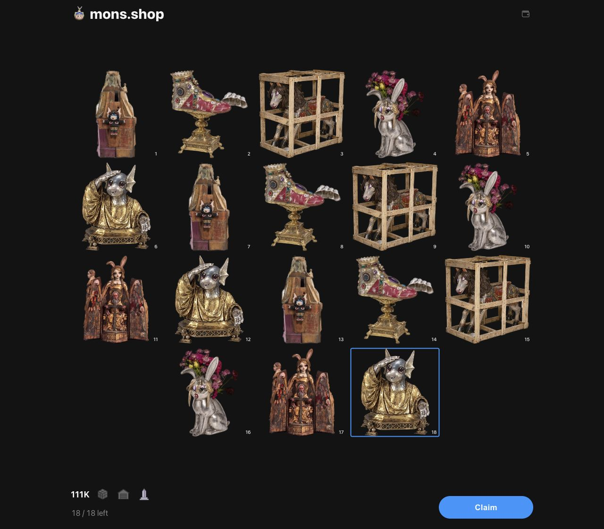
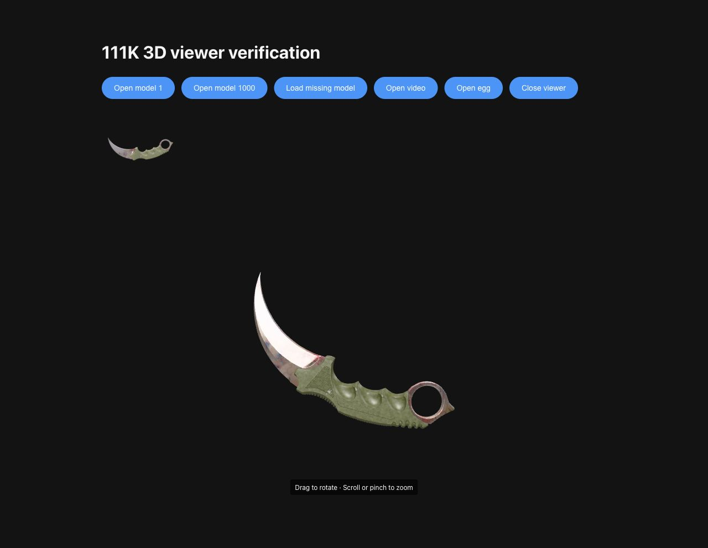

# 111K Sepolia v13 — 3D artworks

**Live and open.** The [111K testnet page](https://mons.shop/111k_devnet) uses v13,
with sales and relic claims enabled. Final verification confirmed zero NFTs minted
and all eighteen relic claim slots unused. No QA mint, unpack, or relic claim
transactions were submitted.

| Item | Value |
| --- | --- |
| Contract | [`0x8ef2789bc22098749a8ca746263fd85442949eff`](https://sepolia.etherscan.io/address/0x8ef2789bc22098749a8ca746263fd85442949eff) |
| Deployment block | 12051125 |
| Deployment transaction | [Confirmed creation](https://sepolia.etherscan.io/tx/0x170f5f3ec6cb9f3e563251d80efa849c6818414fcd222dac21f14a4dfe0c801f) |
| Relic reservation | [18 relics / 0.018 Sepolia ETH](https://sepolia.etherscan.io/tx/0x08220a98bc1c90e818772f4fbed86a2f778876813a4b0b46ee6848b779a1134e) |
| Sale opening | [Confirmed opening](https://sepolia.etherscan.io/tx/0x29d9d33c14d74f3eb9fc7e750c3e0ea6205cf773948dbf61dd2417df12232605) |
| Metadata prefix | `https://cdn.mons.shop/111k-sepolia/v13/` |
| Reveal catalog | `111k-v2` |
| Source | [Sourcify](https://repo.sourcify.dev/11155111/0x8ef2789bc22098749a8ca746263fd85442949eff), [Etherscan Similar Match](https://sepolia.etherscan.io/address/0x8ef2789bc22098749a8ca746263fd85442949eff#code) |

The new reveal pool contains 22,222 eggs, 84,556 paintings, 3,333 videos, and 1,000
3D models, preserving the 111,111-artwork supply and existing onchain token ranges.
Painting assets 84,557–85,556 are replaced by 3D assets 1–1,000. A model's GLB URL
is published as `animation_url`, its square WEBP preview as `image`, and both its
category and type trait are `3d`.

The shop uses static previews in inventory grids and reveal galleries. Its detail
viewer loads a model on demand with rotation, zoom, keyboard controls, and reset;
loading and failure retain the preview. Videos continue to use MP4 playback.
The [reveal API guide](../../scripts/docs/111k_reveal.md) documents the four
categories and the distinction between metadata `revealStatus` and API responses.

The [source manifest](source-manifest.json) records the frozen source, catalog,
constructor inputs, and helper checksums, including working-tree changes. The
contract retains the Solidity 0.8.38 / 500-run legacy-pipeline Prague build, with
24,401 bytes of runtime code. No Solidity supply or media-category change was
required. The [closed deployment verification](deployment-reserved.json) checks
the eighteen reserved relics, current seven-wallet allowance profile, zero
issuance, and untouched preorder deposit.

The [Etherscan verification](etherscan-verification.json) records its existing
Similar Match to v12 and the visible `claimRelic` write interface. Its referenced
release has the same 22 frozen source files and compiler settings. Exact frozen
source, creation-bytecode, and runtime-bytecode comparisons are recorded by
[Sourcify verification](NFT111K.sourcify-verification.json). Etherscan's web form
reported that an additional exact-match verification was unavailable for the
current credential; its published label remains Similar Match.

All [344,984 metadata objects](metadata-verification.json) were published and
verified at the fresh prefix. The [3D media audit](3d-media-validation.json) checks
all 1,000 GLB files and 1,000 square WEBP previews for public access, MIME type,
CORS, file headers, and image dimensions. Every preview is 1024 × 1024.

[Validation](validation.json) records passing frontend/API deployment checks,
the deterministic local 3D reveal and reorg lifecycle, browser media behavior,
and the resolved timeouts from an initial concurrent full-suite run.

The [application release](application-release.json) identifies the deployed API
and frontend versions. [Cutover acceptance](cutover-acceptance.json) confirms
matching collection settings, active v13 reveals, paused v12, and unchanged
mainnet metadata and registration. The [live reveal check](live-reveal-check.json)
confirms v13 reports unminted token IDs without publishing artwork and v12 returns
`409`. [Final open checks](http-open.json) verify all seven wallets' allowances and
simulate relic claims without sending transactions; the 0.018 ETH deposit remains
undistributed.

V12 sales, redemptions, and reveal admission are paused. Its scoped commerce reset
backed up and removed one reconciliation cursor; no orders, quotes, checkouts, or
claims existed. Its NFTs, metadata, and reveal records remain preserved. The
[acceptance-helper amendment](acceptance-helper-amendment.json) records a correction
to the read-only relic availability URLs without changing frozen runtime or
transaction inputs.

