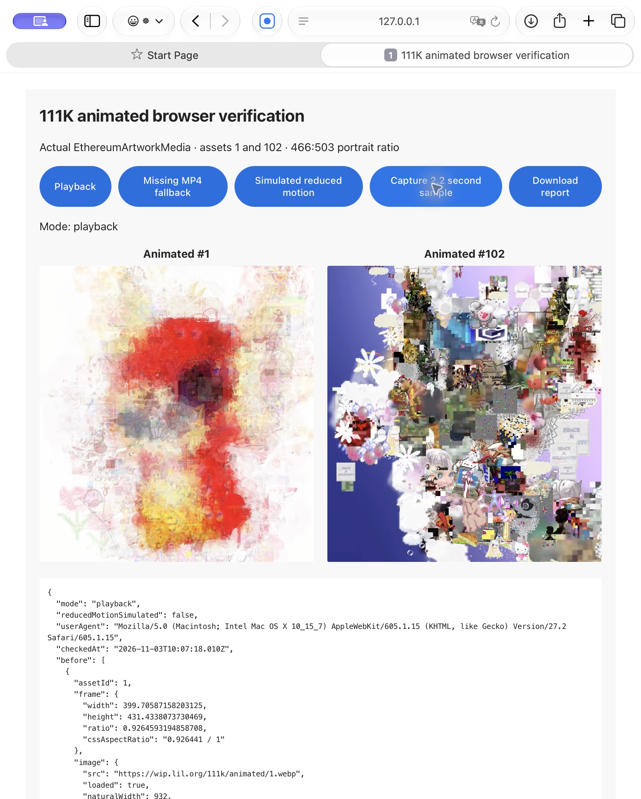

# 111K Sepolia v14 — animated artworks

**Live and open.** The [111K testnet page](https://mons.shop/111k_devnet) uses v14, with sales and relic claims enabled.

| Item | Value |
| --- | --- |
| Contract | [`0x6d194e6cc762424e408b84907c25d60f0db29d12`](https://sepolia.etherscan.io/address/0x6d194e6cc762424e408b84907c25d60f0db29d12) |
| Deployment block | 12054659 |
| Deployment transaction | [Confirmed creation](https://sepolia.etherscan.io/tx/0x2ac17afbb6619f24f4085f3ff65cd56c35a893a65ac1062dd8227c7016f20fe8) |
| Relic reservation | [18 relics / 0.018 Sepolia ETH](https://sepolia.etherscan.io/tx/0x8092b72ee3b681912386ec7c006cbf919e65382c444b34ebfa62f497bf6f464c) |
| Sale opening | [Confirmed opening](https://sepolia.etherscan.io/tx/0x98de127ce61c2af44040043338b824334d19c3f2456cd594b58bb1543f14c2f3) |
| Metadata prefix | `https://cdn.mons.shop/111k-sepolia/v14/` |
| Reveal catalog | `111k-v3` |
| Source | [Sourcify](https://repo.sourcify.dev/11155111/0x6d194e6cc762424e408b84907c25d60f0db29d12), [Etherscan Exact Match](https://sepolia.etherscan.io/address/0x6d194e6cc762424e408b84907c25d60f0db29d12#code) |

The fresh pool contains 22,222 eggs, 84,454 paintings, 3,333 videos, 1,000 3D
models, and 102 animated artworks: 111,111 artworks in total. Animated IDs 1–102
replace painting IDs 84,455–84,556 in this catalog. Historical assignments and
metadata are preserved.

Animated metadata uses matching `animated/{id}.webp` previews and
`animated/{id}.mp4` playback URLs, with `animated` as both its category and type
trait. The per-asset ratio palette starts at 466:503, exactly representing the
932 × 1006 media, and supports different ratios for future assets. Inventory and
reveal views reuse the existing muted looping video player, poster fallback,
viewport loading, and reduced-motion handling.

The [animated template](../../scripts/ethereum-metadata/reveal-assets/111k_devnet/animated.template.json)
documents the revealed metadata shape. [Reference generation](animated-reference-generation.json)
records all 102 generated asset-specific JSONs, which retain `{{tokenId}}` until
assignment. All [344,984 baseline objects](metadata-verification.json) were
generated, published, and verified at the fresh prefix. The reveal service
assigns assets to token IDs and publishes their metadata after confirmation.
The [reveal API guide](../../scripts/docs/111k_reveal.md) documents all five categories.

The [media audit](animated-media-validation.json) verified every MP4 and WEBP:
204 successful public responses with expected MIME/CORS, dimensions, headers,
and full FFmpeg decoding. Browser evidence covers actual playback of assets 1
and 102, portrait layout, poster fallback, and simulated reduced motion.
Further browser work stopped at the user's request; viewer-specific reduced
motion remains covered by component tests.

[Validation](validation.json) records passing frontend/API release checks,
contract and deployment tests, and the deterministic local animated/3D reveal
and reorg lifecycle. One metadata restoration test timed out during the initial
concurrent full-suite run; the separate full frontend run passed all 4,903 tests.
No public QA mint, unpack, or relic claim transactions were submitted.

The [source manifest](source-manifest.json) freezes the runtime, catalog,
constructor inputs, and release helpers. This deployment includes the existing
committed lifetime discounted-mint cap, set to 5,555 for Sepolia; adding the
animated category required no Solidity changes. The Solidity 0.8.38 / 500-run
legacy-pipeline Prague build has 24,555 runtime bytes. [Sourcify verification](NFT111K.sourcify-verification.json)
checks the frozen sources, creation/runtime bytecode, and constructor arguments.
[Etherscan verification](etherscan-verification.json) confirms an exact source
match and the published `claimRelic` write interface.

The [closed reservation verification](deployment-reserved.json) confirms eighteen
reserved relics, the existing seven-wallet allowances, zero issuance, and the
untouched 0.018 ETH deposit. The [application release](application-release.json)
identifies the deployed API and frontend versions. [Cutover acceptance](cutover-acceptance.json)
confirms matching settings, active v14 reveals, paused v13, and unchanged mainnet
metadata and registration. The [live reveal check](live-reveal-check.json) confirms
unminted v14 tokens stay unpublished and retired v13 requests return `409`.
[Opening verification](deployment-open.json) records the confirmed sale opening.
[Final checks](http-open.json) verify all seven wallets’ allowances and simulate
relic claims without sending transactions. Zero NFTs were minted, all eighteen
claim slots remain unused, and the 0.018 ETH deposit remains undistributed.

V13 sales, redemptions, and reveal admission are paused. Its scoped commerce reset
backed up and removed one checkout and one reconciliation cursor. Its NFTs,
published metadata, and reveal ledger remain preserved.

