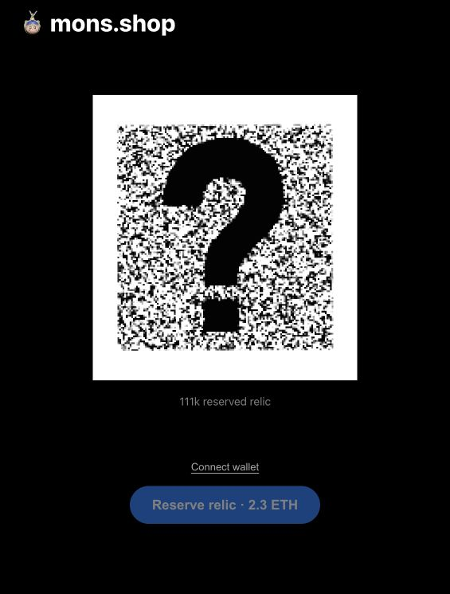

# pre111k mainnet v1

The [mainnet reservation page](https://mons.shop/111k/relics) accepts
backend-authorized relic reservations for **2.3 ETH**, with a lifetime cap of
**18**. Mainnet uses its own authorization signer and reservation counts.

| Item | Value |
| --- | --- |
| Contract | [`0x0a00d0a121cf14632845a16651d43941e8107f08`](https://etherscan.io/address/0x0a00d0a121cf14632845a16651d43941e8107f08) |
| Deployment | [Transaction](https://etherscan.io/tx/0x56f4499c210069ce8d6acff1116a792f4446b32fa1dbb39f3adcec0fe6ef5f80), block **26326977** |
| Deployer | `0xd58d143ca63d9baccc33fdf69ea203f59c58ae93` |
| Administrator and treasury | `0x72D0c5623A05033F9eE4495D408BC6c05DF8367d` |
| Authorization signer | `0x43c829cbb3648cc5eb8ebaa15fb7cfab21ecc2ea` |
| Verified source | [Etherscan](https://etherscan.io/address/0x0a00d0a121cf14632845a16651d43941e8107f08#code), [Sourcify](https://repo.sourcify.dev/1/0x0a00d0a121cf14632845a16651d43941e8107f08), [Routescan](https://routescan.io/address/0x0a00d0a121cf14632845a16651d43941e8107f08?chainid=1) |
| Build | Solidity 0.8.38, optimizer 500 runs, Prague, 3,620-byte runtime |
| Deployment gas | 876,487 gas; **0.000066603508251459 ETH** paid |
| API version | `c6014070-3196-4b67-9aa0-80c61cd7023d` |

[Deployment evidence](deployment.json) verifies the canonical receipt, creation
input, runtime, immutable roles, price, signer, cap, ten-minute authorization
lifetime, zero initial reservations, and zero initial contract balance. The
frozen compiler input and artifact match the Sepolia release. Mainnet sets the
existing Safe directly as administrator; the deploying wallet has no mainnet
administrative role.

[Source hashes](source-manifest.json) and
[Sourcify verification](Pre111K.sourcify-verification.json) bind the published
sources and constructor arguments to the deployed bytecode. The build omits its
metadata hash, so Sourcify reports `match`. [Etherscan verification](Pre111K.etherscan-verification.json)
confirms an exact match, all fifteen frozen sources, the compiler and optimizer,
and the constructor arguments after direct API submission.
[External verification](external-verification.json) records explorer results.
Blockscout accepted the exact frozen source submission, but
its source publication was still unconfirmed at the final check.

[Validation](validation.json) records the contract tests, fresh mainnet-fork Safe
withdrawal, deployment-tool checks, complete API checks, and remote database
integrity checks. [Live acceptance](live-acceptance.json) verifies a real backend
authorization and executes it only through `eth_call` with a simulated wallet
balance. No purchase was broadcast, and all eighteen initial mainnet slots
remained available. Sepolia's configuration was preserved, including existing
reservations.

[Application release](application-release.json) records the API activation and
source hashes. No frontend publication or database migration was needed.
NFT111K and its relic claim allowances were unchanged.

Browser acceptance confirmed the artwork, wallet control, and 2.3 ETH price.
The disconnected reservation button remains disabled until a wallet is connected.

Anyone can call `withdraw()` to forward the entire contract balance exclusively
to the fixed treasury. The Safe alone can rotate the authorization signer.
The contract does not mint NFTs or provide transfers, cancellations, or refunds.
See the [operations guide](../../scripts/docs/pre111k.md) and
[deployment guide](../../onchain/ethereum/PRE111K.md).
